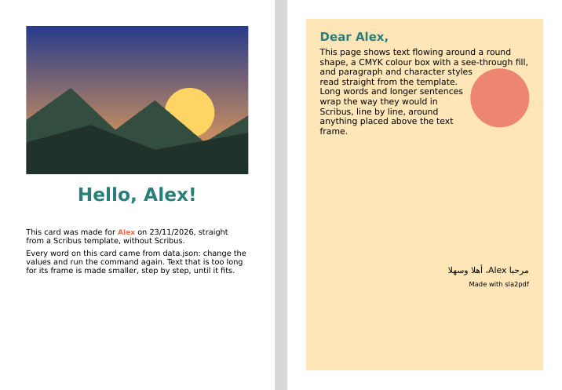

# sla2pdf

Render [Scribus](https://www.scribus.net/) `.sla` templates to PDF **without running Scribus**.

Design a document in Scribus, put placeholders like `%VAR_name%` in its text, then fill them
from a small JSON file and get a PDF in about a second. It is meant for personalised documents
made on a server (books, cards, certificates, badges, letters), where running the Scribus
desktop application headless is slow, fragile and awkward to install.



```sh
pip install .
python -m sla2pdf examples/postcard.sla --data examples/data.json -o postcard.pdf
```

`examples/data.json` is a flat JSON object; every `%VAR_key%` in the template's text (and in
picture file names) is replaced by its value:

```json
{ "name": "Alex", "date": "23/11/2026", "picture": "landscape.png" }
```

From Python:

```python
from sla2pdf import render_document, load_values

result = render_document("card.sla", load_values("data.json"), "card.pdf")
print(result.pages, result.seconds)
for line in result.log:   # font substitutions, missing pictures, shrunk or overflowing text…
    print(line)
```

## What it does

- Reads the Scribus file itself (XML): pages, layers (non-printing layers are left
  out), text frames, picture frames and shapes, with position, size, rotation and flips.
- **Text**: paragraph and character styles with their inheritance, font, size, line spacing
  (fixed and automatic), left / centred / right alignment, tabs, frame padding, colours and
  shades, horizontal scaling, outlined and shadowed text. Words and lines are measured in the
  real font with [HarfBuzz](https://harfbuzz.github.io/), so right-to-left scripts such as
  Arabic and Hebrew, and Cyrillic, Greek, etc. come out right.
- **Text flows around** shapes and pictures placed over it (Scribus "text flows around frame").
- **Text that doesn't fit** is made a little smaller, step by step, until it does, instead of
  being cut off. Long names and translations stay inside their frames. Anything that still
  overflows is reported.
- **Missing letters** are caught: a character the chosen font doesn't have is drawn from a
  fallback font and reported, never shown as an empty box.
- **Pictures**: picture frames with the template's scale and offset, "scale to frame" with or
  without keeping proportions, shaped frames (clipping paths) and transparent pictures.
  Picture file names may contain placeholders too (`%VAR_hair%_girl.png`).
- **Colours**: RGB and CMYK colours from the document, with shade and fill transparency. CMYK
  becomes RGB by a simple formula, or colour-managed with your own ICC profile
  (`--cmyk-profile`).
- Writes a normal PDF with the fonts embedded (subset).

## What it doesn't do (yet)

It covers what a typical personalised-document template needs, not everything Scribus can do.
Not supported, or only partly:

- **Linked text frames** (text continuing from one frame into the next): each frame is laid out
  on its own.
- **Several columns** in one frame: laid out as one column (reported in the log).
- **Justified text**: laid out as left-aligned.
- **Hyphenation**: lines only break at spaces and existing hyphens.
- **Outlines (strokes) of shapes and frames, arrows, dashed lines**: shapes are drawn filled only.
- **Gradients, patterns, blend modes, drop shadows of frames**: not drawn.
- **Tables, text on a path, PDF/X, spot colours, colour-managed RGB output**: not supported.
- **Inline graphics in text, footnotes, master pages / page numbers, symbols and other special
  fields**: not supported.
- **Grouped items** are drawn as their separate parts; group-level transformations may not be.
- Fonts are found with fontconfig (`fc-list`): they have to be installed on the machine.
- Tested with templates from Scribus 1.5 and 1.6. Older or newer file formats may need changes.

If a template uses something unsupported, render it once and read `result.log`: font
substitutions, missing pictures and overflowing text are listed there.

## Requirements

- Python 3.10 or newer
- [fpdf2](https://py-pdf.github.io/fpdf2/), [uharfbuzz](https://github.com/harfbuzz/uharfbuzz)
  and [Pillow](https://python-pillow.org/) (installed with `pip install .`)
- fontconfig (`fc-list`), standard on Linux, available on macOS through Homebrew or MacPorts
- The fonts your templates use, plus a fallback font (default: DejaVu Sans)

## Tests

```sh
pip install ".[test]"
pytest
```

## Status

Provided as-is. It was written for one real job (a personalised children's book service
whose books were designed in Scribus) and then extracted and generalised. Issues and pull
requests are welcome, but no support is promised.

## Licence

GNU General Public License v3.0 or later. See [LICENSE](LICENSE).
Scribus is a trademark of its authors; this project is not affiliated with the Scribus project.
